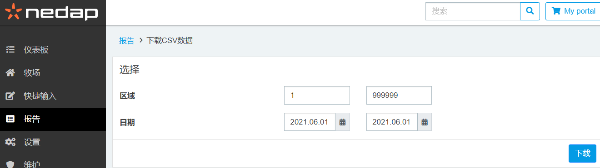
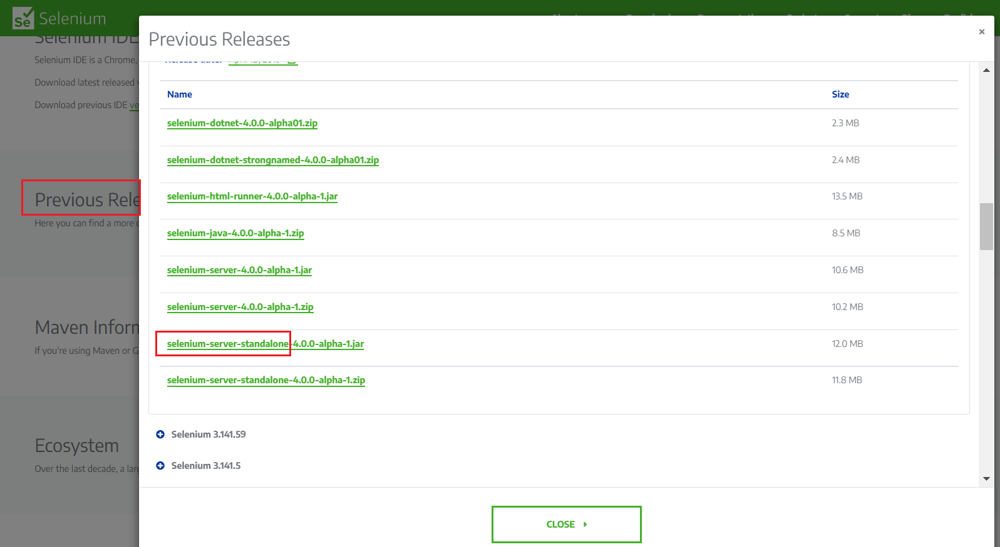
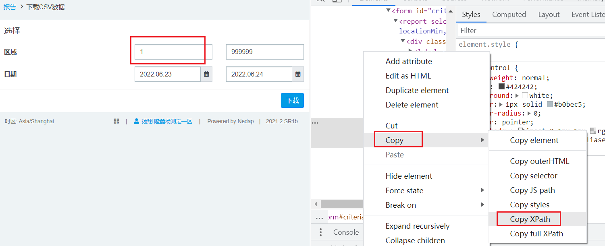
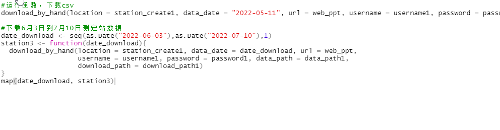

一直都想实现睿保乐nedap测定站的csv数据自动下载，实在是每天都要从睿保乐系统中下载数据，修改文件名比较麻烦，尤其是很多台测定站同时工作的时候，下载数据都会占用较多的时间又容易搞乱。为了解决这个问题，我使用R语言对睿保乐系统实行动态爬取（姑且这样叫吧😂，因为和平时遇到的爬虫不太相同）。希望这篇文章可以为育种行业中涉及测定站的人提供一些提高工作效率的方法，也为其他人有类似的需要的人提供参考。

<!--more-->

<p align="center">
    
</p>

## 手动下载的难点

一般的做法那就是一台测定站每天每天的下载，要下载几十上百台；其次，就是选定多台测定站一天或者一台测定站多天数据来下载。但因为不能一次性下载太多，选定日期和测定站范围太大会导致下载的数据不完整，无论你怎么选择，都是要人工手动进行下载，如果每天下载几百台测定站，没有个把小时是比较难搞定的。

## 思路与环境准备

我的思路是依托R平台，使用<font color=red> Selenium + chromedriver + RSelenium + taskscheduleR + purrr</font> 来实现定时自动下载所有数据。

> Selenium 是一个用于Web应用程序测试的工具。Selenium测试直接运行在浏览器中，就像真正的用户在操作一样。

-   下载安装谷歌浏览器并安装；

-   下载和谷歌浏览器对应版本的chromedriver；

    [*http://chromedriver.storage.googleapis.com/index.html*](http://chromedriver.storage.googleapis.com/index.html)

    [*https://registry.npmmirror.com/binary.html?path=chromedriver/*](https://registry.npmmirror.com/binary.html?path=chromedriver/)

-   下载selenium-server，本地也必须已经安装java；

    [*https://www.selenium.dev/downloads/*](https://www.selenium.dev/downloads/)

    

-   在R中安装RSelenium包，通过R代码指令控制谷歌浏览器，替代鼠标点击网站页面；

    

-   使用谷歌浏览器打开网页，将光标放在所需要点击和输入的地方，点击鼠标右键，选择\~\~\~\~检查，拷贝xpath；

    

-   按照点击顺序，分别获取xpath。模仿点击网页，输入文本等，最后组合成函数；

-   将以下代码放到.bat文件中，双击运行，必须运行Selenium后，在R中才能使用RSelenium包；

    

-   使用purrr包循环运行编写的函数，生成R脚本，实现循环下载；

-   使用taskscheduleR包实现定时运行R脚本；

## 实现效果

通过下面的代码，可以实现如下效果：

1.  按照设置的测定站编号范围和日期范围，自动下载

    

2.  自动将下载的csv数据修改文件名后移动到指定文件夹

    .gif)

## 完整代码

``` r
# load packages
library(RSelenium)
library(purrr)
library(stringr)

# main function code

download_by_hand <- function(location, data_date, url, username, password, download_path, data_path, ...){
  remDr <- remoteDriver(remoteServerAddr = "127.0.0.1" 
                        , port = 4444
                        , browserName = "chrome")#连接Server
  
  remDr$open() #打开浏览器
  remDr$navigate(url) #打开网址
  
  login_user <- '//*[@id="frmLogin"]/div[2]/input'
  login_passwd <- '//*[@id="frmLogin"]/div[3]/input'
  
  login_user_ele<-remDr$findElement("xpath",login_user)
  login_passwd_ele<-remDr$findElement("xpath",login_passwd)
  user<-list(username)
  pass<-list(password)
  login_user_ele$sendKeysToElement(user)
  login_passwd_ele$sendKeysToElement(pass)
  
  login <- '//*[@id="login_button"]'
  login_ele<-remDr$findElement("xpath",login)
  remDr$mouseMoveToLocation(webElement = login_ele)
  remDr$click()
  
  Sys.sleep(10) #暂停10秒，给网页反应时间来打开
  
  iter_download <- function(station, data_date, ...){
    #选择nedap网站《报告》
    choose_item <- '/html/body/div[1]/div[1]/ul/li[4]/a'
    choose_ele<-remDr$findElement("xpath",choose_item)
    remDr$mouseMoveToLocation(webElement = choose_ele)
    remDr$click()
    
    #选择<报告>中的<下载csv数据>
    download_item <- '//*[@id="reports_page"]/div[2]/div/div[3]/ol/li[1]/a'
    download_ele<-remDr$findElement("xpath",download_item)
    remDr$mouseMoveToLocation(webElement = download_ele)
    remDr$click()
    
    #choose_locations
    location_start <- '//*[@id="criteria"]/report-selection-range/div/div/div/div[1]/input'
    location_end <- '//*[@id="criteria"]/report-selection-range/div/div/div/div[2]/input'
    location_ele_start<-remDr$findElement("xpath",location_start)
    location_ele_end<-remDr$findElement("xpath",location_end)
    
    location_ele_start$clearElement() #清空输入框内容
    location_ele_end$clearElement() #清空输入框内容
    
    location_start_num <- list(station, key = "enter")
    location_ele_start$sendKeysToElement(location_start_num)
    location_ele_end$clickElement()#单击鼠标
    #选择下载日期
    date_start <- '//*[@id="datetimepicker0"]/input'
    date_end <- '//*[@id="datetimepicker1"]/input'
    date_ele_start<-remDr$findElement("xpath",date_start)
    date_ele_end<-remDr$findElement("xpath",date_end)
    
    date_ele_start$clearElement() #清空输入框内容
    
    date_need_to_download <- stringr::str_replace_all(as.character(data_date),"-",".")
    
    date_start_num <- list(date_need_to_download, key = "enter")
    date_end_num <- list(date_need_to_download, key = "enter")
    date_ele_start$sendKeysToElement(date_start_num)
    date_ele_end$clearElement()
    date_ele_end$sendKeysToElement(date_end_num)
    
    #download csv数据
    download_button <- '//*[@id="reports_download_csv_data"]/div[4]/button'
    download_button_ele<-remDr$findElement("xpath",download_button)
    remDr$mouseMoveToLocation(webElement = download_button_ele)
    remDr$click()
    
    remDr$refresh() #刷新网页
  }
  
  walk2(location, data_date, iter_download, ...) #以需求数据日期和测定站编号作为参数，迭代循环下载
  
  Sys.sleep(2) #暂停2秒
  
  process_csv <- function(download_path, data_path, ...){
    down_list <- list.files(path = download_path, all.files = T,full.names = T, recursive = F, pattern = ".csv$")
    #选择当天下载的数据
    down_list_keep <- down_list[lubridate::as_date(file.info(down_list)$mtime) == lubridate::as_date(Sys.time())]
    dir.create(paste0(here::here(data_path,"have_data")), showWarnings = FALSE)
    dir.create(paste0(here::here(data_path,"no_data")), showWarnings = FALSE)
    rename_csv <- function(csv, ...){
      csv_name <- tools::file_path_sans_ext(basename(csv))
      ppt_region <- str_extract(csv_name, "(?<=_)[:lower:]+\\d+(?=.)")
      location_region <- str_extract(csv_name, "(?<=_)[:lower:]+\\d+-\\d+(?=_)")
      download_date <- str_extract(csv_name, "(?<=_)\\d+-\\d+-\\d+(?=_)")
      download_date_trans <- str_replace_all(as.character(download_date), "-", ".")
      csv_new_name <- paste0(ppt_region,"_",location_region,"_", data_date, "data", "_",download_date_trans,"download", ".csv")
      ifelse(file.size(csv) < 1024, dir.create(paste0(here::here(data_path,"no_data"),"/",location_region), showWarnings = FALSE), dir.create(paste0(here::here(data_path, "have_data"),"/",location_region), showWarnings = FALSE))
      ifelse(file.size(csv) < 1024, file.rename(csv, paste0(here::here(data_path,"no_data"),"/",location_region, "/",csv_new_name)), file.rename(from = csv, to = paste0(here::here(data_path, "have_data"),"/",location_region, "/",csv_new_name)))
    }
    purrr::walk(down_list_keep, rename_csv, ...) #迭代修改所下csv数据文件名称
  }
  process_csv(download_path, data_path, ...) #迭代移动修改过文件名的csv文件到指定文件夹
  remDr$quit() #退出
}

#参数设置
web_ppt <- "睿保乐nedap测定站系统网址（外网或内网网址都可）"
username1 <- "用户名"
password1 <- "用户密码"
download_path1 = "设置csv下载路径"
data_path1 = "指定放置修改过文件名的csv的文件夹路径"
station_create1 <- purrr::map_chr(seq(101L,110L,1L), c) #101到110编号测定站

#运行函数，下载101到110测定站2022-05-11日的csv数据
download_by_hand(location = station_create1, data_date = "2022-05-11", url = web_ppt, username = username1, password = password1, data_path = data_path1, download_path = download_path1)

#运行函数，下载6月3日到7月10日范围内101到110测定站的csv数据
date_download <- seq(as.Date("2022-06-03"),as.Date("2022-07-10"),1)
all_csv_download <- function(date_download){
  download_by_hand(location = station_create1, data_date = date_download, url = web_ppt, 
                   username = username1, password = password1, data_path = data_path1, 
                   download_path = download_path1)
}
map(date_download, all_csv_download)
```

## 参考链接

1.  <https://www.bilibili.com/video/BV1354y1p7GY?p=1>

2.  <https://blog.csdn.net/qq_38984677/article/details/81353537>
