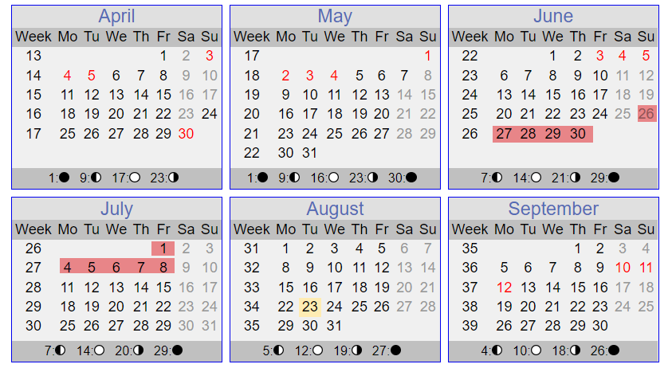

<p style="text-indent:2em;font-size:;font-family:;">
有关日期格式的转换困扰了我一段时间，特别是从周次倒推日期。这篇文章记录周日和日期之间的相互转换。
</p>

<!--more-->

<p style="text-indent:2em;font-size:;font-family:;">
将日期”年-月-日“其转为“年-周-第几天”的格式。其中%Y返回年；%U返回以周日为开始的周号，%u返回从1到7的weekday，1表示周一；%W返回从周一开始的周号，%w返回从0到6的weekday，0表示周日。
</p>


```r
# load packages
library(tidyverse)
library(lubridate)
```

#### 1. 日期转周次


```
## [1] "国内：2022年33周第7天" "国内：2022年34周第1天" "国内：2022年34周第2天"
```

```
## [1] "国外：2022年34周第0天" "国外：2022年34周第1天" "国外：2022年34周第2天"
```

#### 2. 周次转日期


```r
# 国内习惯
#as.Date(x = "2022-33-6", format = "%Y-%W-%u")
#as.Date(x = "2022-33-7", format = "%Y-%W-%u") # ？按道理应该返回“2022-08-21”
#as.Date(x = "2022-34-1", format = "%Y-%W-%u")
#as.Date(x = "2022-34-2", format = "%Y-%W-%u")
c("2022-33-6","2022-33-7","2022-34-1","2022-34-2") %>%
  map_dbl(., ~as.Date(., format = "%Y-%W-%u")) %>%
  as_date()
```

```
## [1] "2022-08-20" "2022-08-14" "2022-08-22" "2022-08-23"
```

```r
# 国外习惯
#as.Date(x = "2022-33-6", format = "%Y-%U-%w")
#as.Date(x = "2022-34-0", format = "%Y-%U-%w")
#as.Date(x = "2022-34-1", format = "%Y-%U-%w")
#as.Date(x = "2022-34-2", format = "%Y-%U-%w")
c("2022-33-6","2022-34-0","2022-34-1","2022-34-2") %>%
  map_dbl(., ~as.Date(., format = "%Y-%U-%w")) %>%
  as_date()
```

```
## [1] "2022-08-20" "2022-08-21" "2022-08-22" "2022-08-23"
```

#### 3. 以27周为列，展示周次与日期的转换


```r
# *_C:China
# *_F:Foreign
map(str_c("2022-",27,"-",1:7), ~as.Date(., format = "%Y-%W-%u")) %>% # 生成27周第1天到第7天的周次和天数
  enframe() %>% 
  unnest(cols = c(value)) %>%
  arrange(value) %>%
  select(-name) %>%
  mutate(
    all_C = format(value, format = "%Y年%W周第%u天"),
    all_F = format(value, format = "%Y年%U周第%w天"),
    week_C = format(value, format = "W%W"), 
    week_F = format(value, format = "W%U"), 
    weekday_C = format(value, format = "%u"),
    weekday_F = format(value, format = "%w"),
    week = lubridate::week(value),
    weekdays = weekdays(value),
    weekday_lubridate = lubridate::wday(value, week_start=1)) %>% 
  gt::gt() %>%
  gt::gtsave("C:/Users/Dell/Desktop/test1.png")
```


```r
cross3(2022, 26:27, 1:7) %>% map_chr(paste, collapse = "-") %>% 
  map(., ~as.Date(., format = "%Y-%U-%u")) %>%
  enframe() %>% 
  unnest(cols = c(value)) %>%
  arrange(value) %>%
  select(-name) %>%
  mutate(
    all_C = format(value, format = "%Y年%W周第%u天"),
    all_F = format(value, format = "%Y年%U周第%w天"),
    week_C = format(value, format = "W%W"), 
    week_F = format(value, format = "W%U"), 
    weekday_C = format(value, format = "%u"),
    weekday_F = format(value, format = "%w"),
    week = lubridate::week(value),
    weekdays = weekdays(value),
    weekday_lubridate = lubridate::wday(value, week_start=1)) %>% 
  gt::gt() %>%
  gt::gtsave("C:/Users/Dell/Desktop/test2.png")
```


<p style="text-indent:2em;font-size:;font-family:;">
根据上表和下图，比较2022-6-26到2022-07-09之间所有日期对应的周次、一周内第几天、星期几都是一一对应的💯。
</p>



#### 4. 周次转日期中，日期的几种形式


```r
year <- 2022
week <- 33
as.Date(paste(year, week, "1", sep=""), "%Y%U%u")
```

```
## [1] "2022-08-15"
```

```r
#> [1] NA
as.Date(paste(year, stringr::str_pad(week,width=2, pad="0"), "1", sep=""), "%Y%U%u")
```

```
## [1] "2022-08-15"
```

```r
#> [1] "2015-01-05"
as.Date(paste(year, week, "1", sep="-"), "%Y-%U-%u")
```

```
## [1] "2022-08-15"
```

```r
#> [1] "2015-01-05"
```

#### 5. 调取对应日期，比较常用


```r
# 1
# 生成对应日期向量，使用filter()进行过滤
map_dbl(str_c("2021-",27,"-",1:7), ~as.Date(., format = "%Y-%W-%u")) %>% as_date
```

```
## [1] "2021-07-05" "2021-07-06" "2021-07-07" "2021-07-08" "2021-07-09"
## [6] "2021-07-10" "2021-07-04"
```

```r
cross3(2022, 32, 1:7) %>% map_chr(paste, collapse = "-") %>% 
  map_dbl(., ~as.Date(., format = "%Y-%U-%u")) %>%
  as_date()
```

```
## [1] "2022-08-08" "2022-08-09" "2022-08-10" "2022-08-11" "2022-08-12"
## [6] "2022-08-13" "2022-08-07"
```

```r
# 3
#对于日期列，使用mutate()函数，mutate(week = format(value, format = "%Y-%W-%u"))
```
