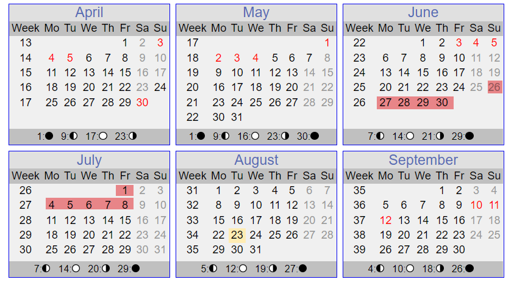
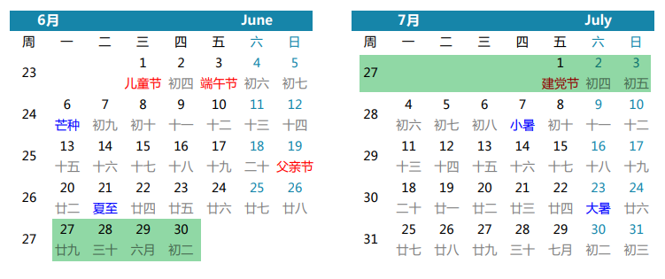

日期是数据处理中最容易出错的地方之一。这篇整理了我遇到过的三类问题：Excel 里一列日期混着两种格式；日期和周次的相互转换；以及按中国习惯（周一是一周的第一天）生成周次表。

<!--more-->


## 1. 一列里混着两种日期格式

在R语言中读取excel/csv数据的过程中经常会遇到日期格式的列变为了字符串，特别是有的字符串是日期形式，有的字符串是数字形式，出现这种情况很大可能是数据本身整理错误的原因。可以利用case_when()和convert_to_date()函数手动进行处理，将字符串日期转为正常的日期格式。

```r
# load packages
library(rio)
library(tidyverse)

# import data
data <- import("C:/Users/Dell/Desktop/test/日期错处处理test.xlsx")

# data head()
head(data)
```

```
##   个体编号 出生日期
## 1   107015    44561
## 2   107016    44561
## 3   107017    44561
## 4   107018    44561
## 5   107019    44561
## 6   107020    44561
```

```r
# data glimpse()
glimpse(data)
```

```
## Rows: 11
## Columns: 2
## $ 个体编号 <dbl> 107015, 107016, 107017, 107018, 107019, 107020, 101351, 101352, 1~
## $ 出生日期 <chr> "44561", "44561", "44561", "44561", "44561", "44561", "2022-05-27~
```

```r
# data process
data %>%
  mutate(出生日期_new = case_when(
    str_detect(出生日期, "-") ~ lubridate::as_date(出生日期),
    TRUE ~ janitor::convert_to_date(出生日期)
  ))
```

```
##    个体编号   出生日期 出生日期_new
## 1    107015      44561   2021-12-31
## 2    107016      44561   2021-12-31
## 3    107017      44561   2021-12-31
## 4    107018      44561   2021-12-31
## 5    107019      44561   2021-12-31
## 6    107020      44561   2021-12-31
## 7    101351 2022-05-27   2022-05-27
## 8    101352 2022-05-27   2022-05-27
## 9    101353 2022-05-27   2022-05-27
## 10   101354 2022-05-27   2022-05-27
## 11   101355 2022-05-27   2022-05-27
```

## 2. 日期与周次互相转换

有关日期格式的转换困扰了我一段时间，特别是从周次倒推日期。这篇文章记录周日和日期之间的相互转换。

将日期”年-月-日“其转为“年-周-第几天”的格式。其中%Y返回年；%U返回以周日为开始的周号，%u返回从1到7的weekday，1表示周一；%W返回从周一开始的周号，%w返回从0到6的weekday，0表示周日。

```r
# load packages
library(tidyverse)
library(lubridate)
```

### 日期转周次

```
## [1] "国内：2022年33周第7天" "国内：2022年34周第1天" "国内：2022年34周第2天"
```

```
## [1] "国外：2022年34周第0天" "国外：2022年34周第1天" "国外：2022年34周第2天"
```

### 周次转日期

```r
# 国内习惯
#as.Date(x = "2022-33-6", format = "%Y-%W-%u")
#as.Date(x = "2022-33-7", format = "%Y-%W-%u") # ？按道理应该返回“2022-08-21”
#as.Date(x = "2022-34-1", format = "%Y-%W-%u")
#as.Date(x = "2022-34-2", format = "%Y-%W-%u")
c("2022-33-6","2022-33-7","2022-34-1","2022-34-2") %>%
  map_dbl(., ~as.Date(., format = "%Y-%W-%u")) %>%
  as_date()
```

```
## [1] "2022-08-20" "2022-08-14" "2022-08-22" "2022-08-23"
```

```r
# 国外习惯
#as.Date(x = "2022-33-6", format = "%Y-%U-%w")
#as.Date(x = "2022-34-0", format = "%Y-%U-%w")
#as.Date(x = "2022-34-1", format = "%Y-%U-%w")
#as.Date(x = "2022-34-2", format = "%Y-%U-%w")
c("2022-33-6","2022-34-0","2022-34-1","2022-34-2") %>%
  map_dbl(., ~as.Date(., format = "%Y-%U-%w")) %>%
  as_date()
```

```
## [1] "2022-08-20" "2022-08-21" "2022-08-22" "2022-08-23"
```

### 以27周为列，展示周次与日期的转换

```r
# *_C:China
# *_F:Foreign
map(str_c("2022-",27,"-",1:7), ~as.Date(., format = "%Y-%W-%u")) %>% # 生成27周第1天到第7天的周次和天数
  enframe() %>% 
  unnest(cols = c(value)) %>%
  arrange(value) %>%
  select(-name) %>%
  mutate(
    all_C = format(value, format = "%Y年%W周第%u天"),
    all_F = format(value, format = "%Y年%U周第%w天"),
    week_C = format(value, format = "W%W"), 
    week_F = format(value, format = "W%U"), 
    weekday_C = format(value, format = "%u"),
    weekday_F = format(value, format = "%w"),
    week = lubridate::week(value),
    weekdays = weekdays(value),
    weekday_lubridate = lubridate::wday(value, week_start=1)) %>% 
  gt::gt() %>%
  gt::gtsave("C:/Users/Dell/Desktop/test1.png")
```


```r
cross3(2022, 26:27, 1:7) %>% map_chr(paste, collapse = "-") %>% 
  map(., ~as.Date(., format = "%Y-%U-%u")) %>%
  enframe() %>% 
  unnest(cols = c(value)) %>%
  arrange(value) %>%
  select(-name) %>%
  mutate(
    all_C = format(value, format = "%Y年%W周第%u天"),
    all_F = format(value, format = "%Y年%U周第%w天"),
    week_C = format(value, format = "W%W"), 
    week_F = format(value, format = "W%U"), 
    weekday_C = format(value, format = "%u"),
    weekday_F = format(value, format = "%w"),
    week = lubridate::week(value),
    weekdays = weekdays(value),
    weekday_lubridate = lubridate::wday(value, week_start=1)) %>% 
  gt::gt() %>%
  gt::gtsave("C:/Users/Dell/Desktop/test2.png")
```


根据上表和下图，比较2022-6-26到2022-07-09之间所有日期对应的周次、一周内第几天、星期几都是一一对应的💯。



### 周次转日期中，日期的几种形式

```r
year <- 2022
week <- 33
as.Date(paste(year, week, "1", sep=""), "%Y%U%u")
```

```
## [1] "2022-08-15"
```

```r
#> [1] NA
as.Date(paste(year, stringr::str_pad(week,width=2, pad="0"), "1", sep=""), "%Y%U%u")
```

```
## [1] "2022-08-15"
```

```r
#> [1] "2015-01-05"
as.Date(paste(year, week, "1", sep="-"), "%Y-%U-%u")
```

```
## [1] "2022-08-15"
```

```r
#> [1] "2015-01-05"
```

### 调取对应日期，比较常用

```r
# 1
# 生成对应日期向量，使用filter()进行过滤
map_dbl(str_c("2021-",27,"-",1:7), ~as.Date(., format = "%Y-%W-%u")) %>% as_date
```

```
## [1] "2021-07-05" "2021-07-06" "2021-07-07" "2021-07-08" "2021-07-09"
## [6] "2021-07-10" "2021-07-04"
```

```r
cross3(2022, 32, 1:7) %>% map_chr(paste, collapse = "-") %>% 
  map_dbl(., ~as.Date(., format = "%Y-%U-%u")) %>%
  as_date()
```

```
## [1] "2022-08-08" "2022-08-09" "2022-08-10" "2022-08-11" "2022-08-12"
## [6] "2022-08-13" "2022-08-07"
```

```r
# 3
#对于日期列，使用mutate()函数，mutate(week = format(value, format = "%Y-%W-%u"))
```

## 3. 按中国习惯生成周次表

使用R语言将日期转化为周次📅，总感觉和中国的习惯不太一样，我找了很多周次表，基本都是每年的第1天开始就算作一年的第1周了，这和国外的好像不同，国外的可能会算做每一年的第0周或去年的第52或53周。我的观念中是每周的第1天从周一开始的，看也有从周日开始的。所以，记录一下R语言中看着顺眼的中国date格式。

```r
#load
library("lubridate")
library("tidyverse")
library("gt")

# defining start date
start_date <- ymd("2022/01/01")
# defining end date
end_date <- ymd("2022/12/31")

# generating range of dates
data.frame(date = seq(start_date, end_date,"days")) %>%
  mutate(week_other = format(date, format = "%W"), #Week with Monday as first day of the week 00-53
         week_China = as.integer(week_other)+1,
         weekday = format(date, format = "%u"), #Weekday Monday is 1
         century = format(date, format = "%C"),
         day_of_year = format(date, format = "%j")) %>%
  filter(week_China == 27) %>%
  gt() %>%
  cols_align("center") %>% 
  gtsave("C:/Users/Dell/Desktop/date_table.png")
```



