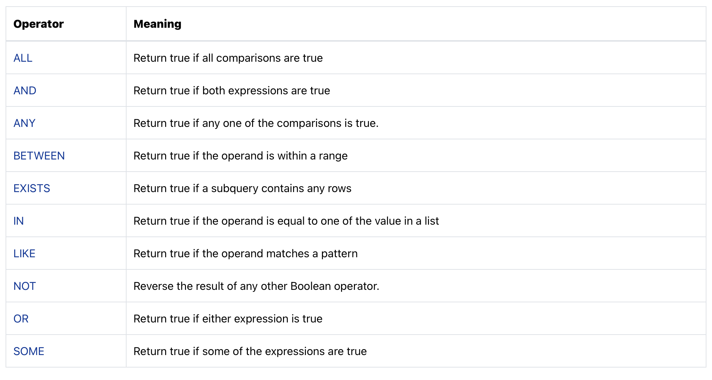

<p style="text-indent:2em;font-size:;font-family:;">
今日学习SQL中的逻辑运算符。和R语言中的使用方法差不多，且命令比较相似，但ALL和ANY真的是难到我了🤣
</p>

<!--more-->


#### 

#### 1. ALL和ANY的使用方法


```sql
SELECT
department_id, first_name, last_name, salary
FROM
employees
WHERE
salary >= ALL(
SELECT
salary
FROM
employees
WHERE
department_id = 8
)
ORDER BY 
salary DESC;
```


<div class="knitsql-table">


Table: Table 1: 4 records

| department_id|first_name |last_name | salary|
|-------------:|:----------|:---------|------:|
|             9|Steven     |King      |  24000|
|             9|Neena      |Kochhar   |  17000|
|             9|Lex        |De Haan   |  17000|
|             8|John       |Russell   |  14000|

</div>

#### 
