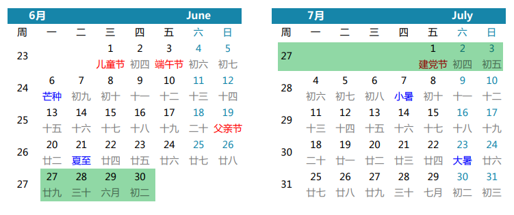

<p style="text-indent:2em;font-size:;font-family:;">
使用R语言将日期转化为周次📅，总感觉和中国的习惯不太一样，我找了很多周次表，基本都是每年的第1天开始就算作一年的第1周了，这和国外的好像不同，国外的可能会算做每一年的第0周或去年的第52或53周。我的观念中是每周的第1天从周一开始的，看也有从周日开始的。所以，记录一下R语言中看着顺眼的中国date格式。
</p>

<!--more-->


```r
#load
library("lubridate")
library("tidyverse")
library("gt")

# defining start date
start_date <- ymd("2022/01/01")
# defining end date
end_date <- ymd("2022/12/31")

# generating range of dates
data.frame(date = seq(start_date, end_date,"days")) %>%
  mutate(week_other = format(date, format = "%W"), #Week with Monday as first day of the week 00-53
         week_China = as.integer(week_other)+1,
         weekday = format(date, format = "%u"), #Weekday Monday is 1
         century = format(date, format = "%C"),
         day_of_year = format(date, format = "%j")) %>%
  filter(week_China == 27) %>%
  gt() %>%
  cols_align("center") %>% 
  gtsave("C:/Users/Dell/Desktop/date_table.png")
```



