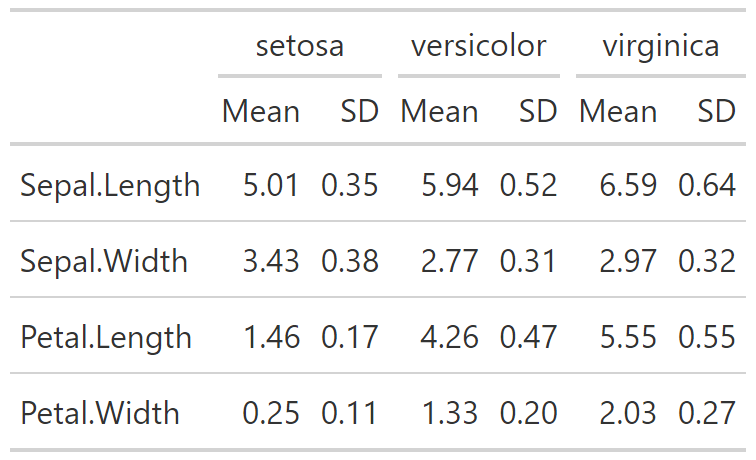

<p style="text-indent:2em;font-size:;font-family:;">
这篇文章是主要是记录图片中插入表格，是在推特中看到的，觉得做的很漂亮，这里想按照原作者的code重新跑一下（实在抵挡不住漂亮图表的诱惑🤣）。看到中间的统计表格，想起了今天看到的modelsummary包中也有类似的统计函数，之前的几篇有关描述性统计的文章也有其他包具有类似的函数（只有你想不到的包），顺便也使用iris数据集来可视化统计表格。
</p>

<!--more-->

<p style="text-indent:2em;font-size:;font-family:;">
从github<a href="https://gist.github.com/davidgohel/eaebc7d00f63166976fd2b29f8cb0abf">该网址处</a>复制粘贴运行，中间稍微修改了一下，感觉原作者图中使用的颜色不好看😁。
</p>

下面是我运行的代码：


```r
library(ggplot2)
library(flextable)
library(patchwork)
library(tidyverse)

main <- ggplot(data = diamonds, aes(x= price, y = x, color = color)) + 
  geom_point() + # diamonds数据集散点图
  theme_minimal() # minimal主题

myscale <- scales::col_numeric(domain = NULL, palette = "Dark2") # 调色板颜色

agg_data <- group_by(diamonds, color) %>% 
  summarise(across(x:z, list(avg = mean, sd = sd))) # 描述性统计

sub <- agg_data %>% 
  flextable() %>% #将数据框格式的agg_data转为flextable格式
  separate_header() %>% # 将表头分开，如x_avg分开为x,avg
  colformat_double(digits = 2) %>% # 保留两位有效数字
  autofit() %>% # 自动调整长宽
  valign(valign = "center", part = "header") %>% # 表头部分居中对齐
  bg(bg = "white", part = "all") %>% # 所有部分的背景颜色设为#CCCCCC
  flextable::color(color = myscale, j = grep("avg$", colnames(agg_data), value = TRUE)) %>% # 将调色板颜色应用到列
  gen_grob(fit = "width", scaling = "min", autowidths = FALSE,
           just = "center")

main + inset_element(sub, 0.5, 0.15, .95, .5)+ # 插入
  theme(rect  = element_rect(fill="transparent")) # 设置主题
```


```r
ragg::agg_png(filename = "C:/Users/Dell/Desktop/flextable.png", width = 10, height = 7,
              res = 300, units = "in") # 导出为图片
```

------------------------------------------------------------------------


```r
# load packages
library(modelsummary)
library(flextable)
library(tidyverse)

# method1
modelsummary::datasummary(All(iris) ~ Species * (Mean + SD),
            data = iris,
            output = 'gt') %>%
  gt::gtsave("C:/Users/Dell/Desktop/gt.png")

#method2
group_by(iris, Species) %>% 
  summarise(across(1:2, list(Mean = mean, SD = sd))) %>%
  flextable::flextable() %>%
  separate_header() %>%
  save_as_image("C:/Users/Dell/Desktop/flextable.png")
```

```
## [1] "C:/Users/Dell/Desktop/flextable.png"
```

-   method1

    

-   method2

    
