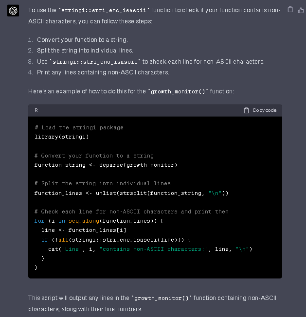

在写R包的过程中遇到non_ASCII,谷歌+chatGPT解决问题。解决过程中，先尝试让chatGPT帮忙写代码找出R函数中的non_ASCII，无一例外都失败了；搜索谷歌，找到一个使用stringi::stri_enc_isascii()来检查每行non_ASCII的方法；让chatGPT使用stringi::stri_enc_isascii()写程序检查每行代码。

<!--more-->

